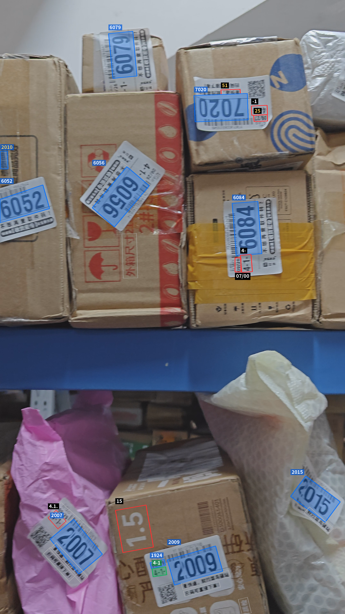
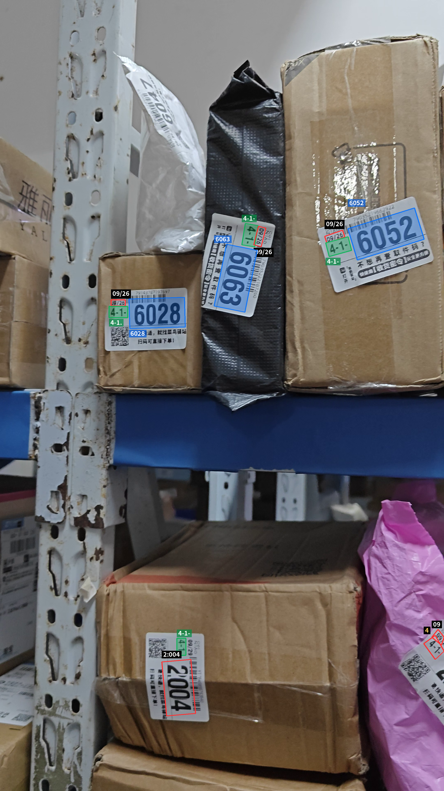
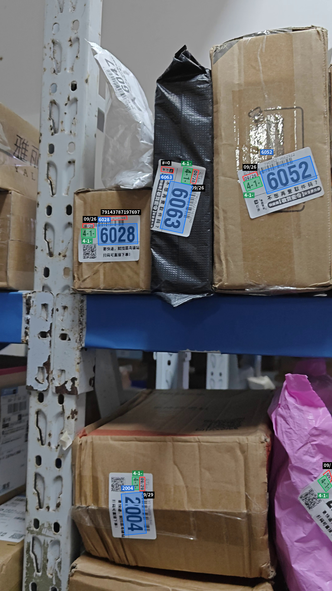

# OCR 标注结果示例

这里保留少量原分辨率 PNG，便于审查可视化效果。批量运行结果仍由 `.gitignore` 中的 `output-*/` 忽略。

| 文件 | 来源 |
|---|---|
| `paddle-image.png` | 原 `output-annotated/image_labeled.png`，Paddle 图片标注结果 |
| `paddle-video-frame-000000.png` | 原 `output-video/frame_000000.png`，Paddle 视频首帧标注结果 |
| `onnx-video-frame-000000.png` | 独立 ONNX Runtime 实现 smoke test 的视频首帧标注结果 |

历史 Paddle 输出未附带完整模型/精度记录，不据此推断当时配置。这些图片用于展示效果，不是严格的模型准确率或性能对照。

## Paddle 图片

## Paddle 视频首帧

## 独立 ONNX 视频首帧

