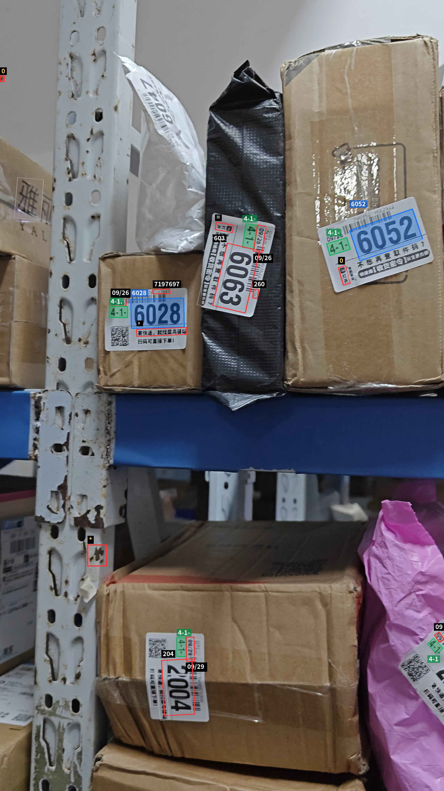
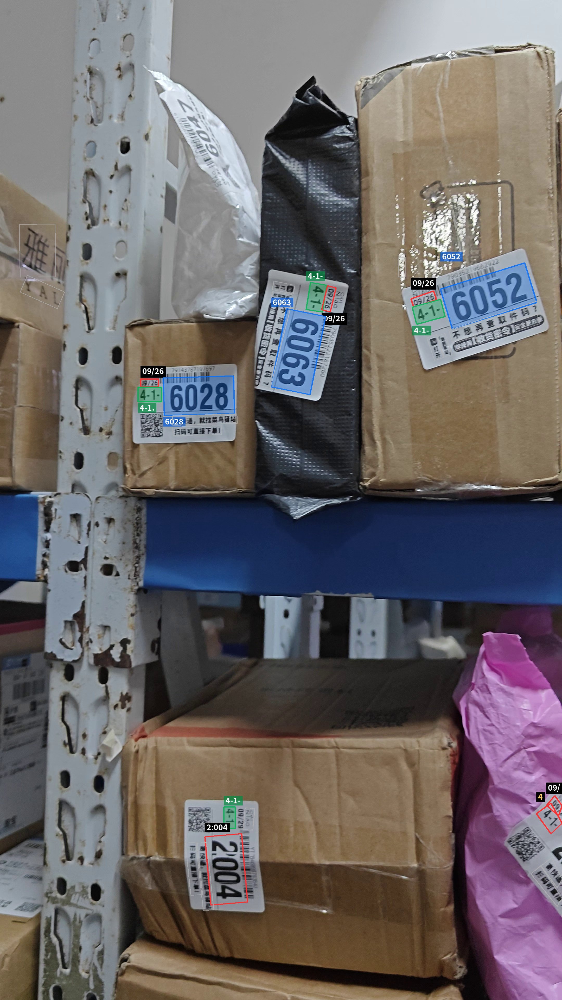
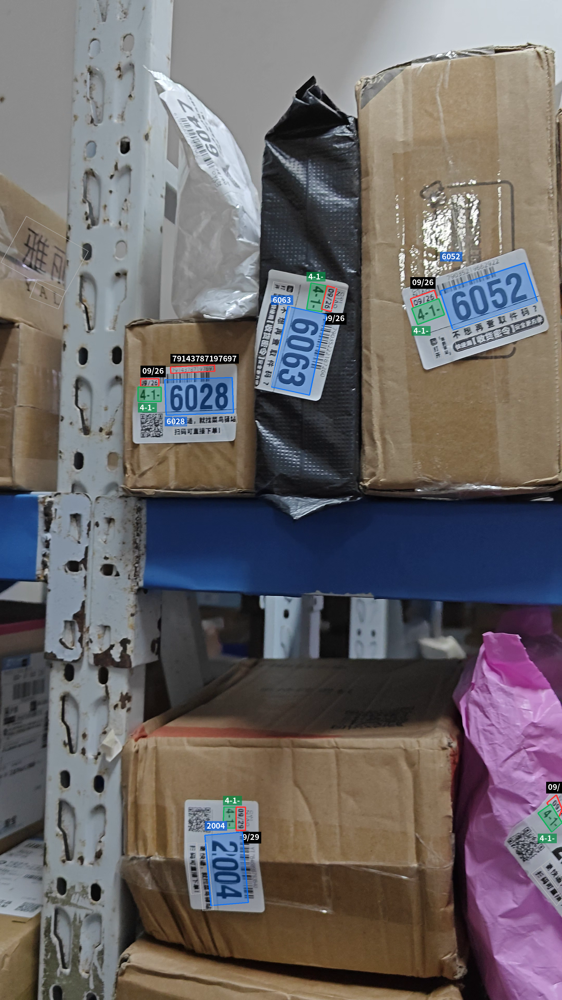

# Paddle Static FP32：v5 Mobile Latin 与 v6 对比

## 配置与方法

GPU：RTX 3090；Paddle 3.2.2；PaddleOCR 3.7.0。

- 三组均使用 Paddle Static FP32（`run_mode=paddle`）。
- `use_textline_orientation=True`，默认方向模型 `PP-LCNet_x1_0_textline_ori`。
- 文档方向分类、文档去畸变关闭。
- 不覆盖检测缩放、识别 batch size 和识别阈值，使用各模型/Pipeline 默认配置；完整导出配置见 `*_pipeline.yml`。
- 原视频 `VID20260929150008.mp4`：选取帧 0、66、133、200、266、333、400，约 0、1.10、2.22、3.33、4.43、5.55、6.67 秒。不是严格每秒抽一帧。
- 每组在独立进程运行，7 帧全部预加载并预热，再测 3 轮，共 21 次预测；使用 GPU 同步计时。
- 时间包含完整 OCR 预测，包括 CPU 前后处理、检测、方向分类与识别，不含视频解码、标注与保存。

## 结果

| 检测 + 识别 | 平均 ms/帧 | 中位数 | P95 |
|---|---:|---:|---:|
| PP-OCRv5_mobile_det + latin_PP-OCRv5_mobile_rec | 202.58 | 201.11 | 221.03 |
| PP-OCRv6_small_det + PP-OCRv6_small_rec | 204.28 | 202.60 | 230.50 |
| PP-OCRv6_medium_det + PP-OCRv6_medium_rec | 308.22 | 313.07 | 352.26 |

此配置下 v5 与 v6 small 速度基本持平；约 0.8% 的差异不宜解释为可靠优势。

第一轮各帧检测/识别条目数：

| 模型 | 数量 |
|---|---|
| v5 Mobile Latin | 36, 42, 38, 49, 34, 20, 21 |
| v6 small | 31, 29, 21, 36, 18, 7, 13 |
| v6 medium | 34, 40, 25, 35, 22, 4, 14 |

识别字典：Latin 836 项且不含中文；v6 两组 18708 项，支持中文。数量和模型间文字重合不是 ground-truth 准确率。更少检测框不等于更准确。

## 首帧可视化

### v5 Mobile + Latin



### v6 small



### v6 medium



提交图片保持原分辨率。其他标注帧和输入视频保留在本地，不提交。

## 复现

从本仓库根目录，使用已有 Paddle GPU 环境：

```bash
.venv/bin/python benchmarks/compare_paddle_models.py \
  --video /path/to/VID20260929150008.mp4 \
  --output output-benchmark-defaults --rounds 3
```

`frames.json` 记录原测试机路径和帧索引；JSON 包含逐帧识别文本、耗时及有效配置。路径仅为实验来源，复现时传入自己的视频路径。

## 限制

测试期间另有 OCR API 进程驻留 GPU，可能产生干扰。无人工标注真值；本实验不是准确率排名。与此前固定检测最大边 960、关闭文本行方向分类的实验不同，不能把差异单独归因于方向分类。本次只更新 benchmark，不改变正式 OCR 脚本的默认参数。
